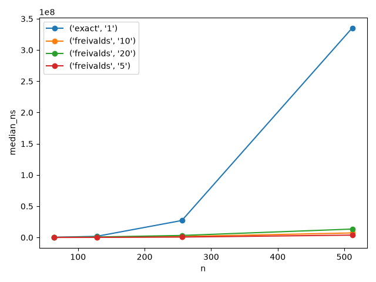
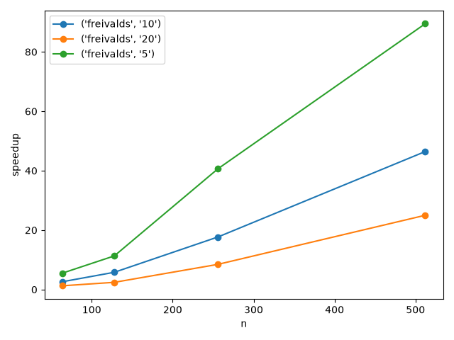
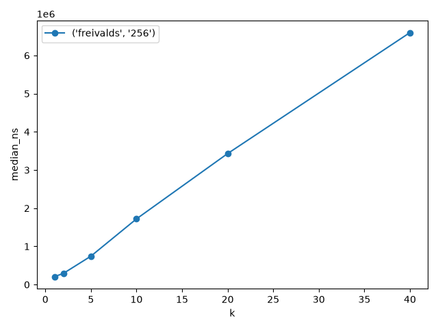
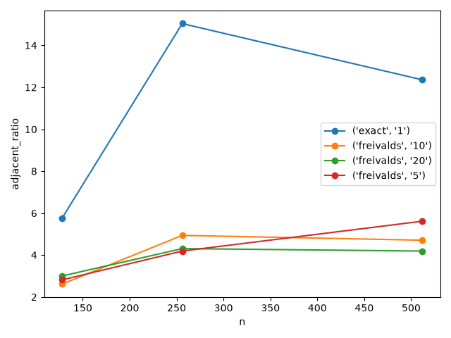
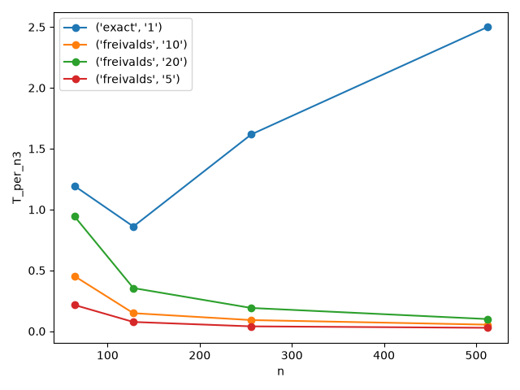
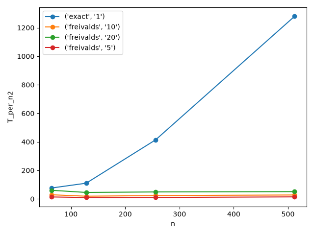
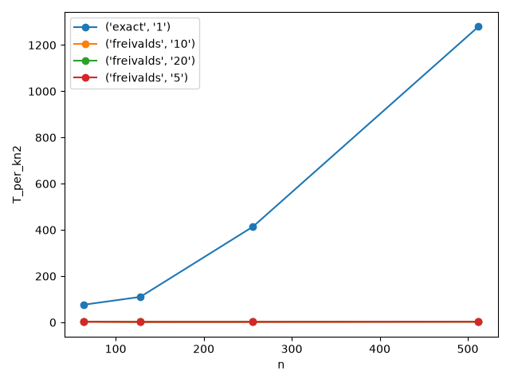
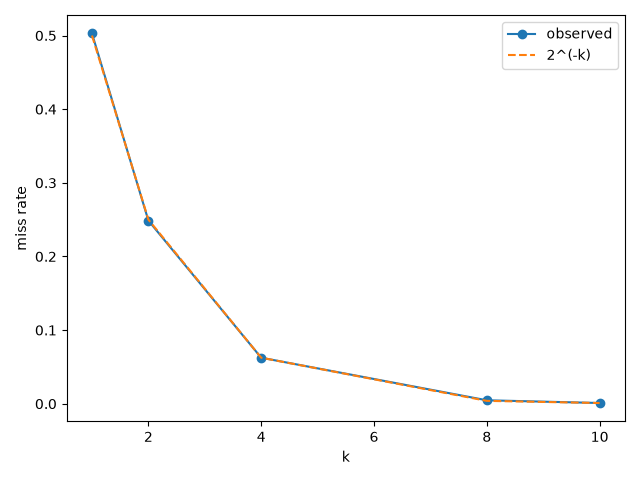

# Freivalds 矩阵乘法随机验证实验报告

初稿；实验日期：2026 年 10 月 20 日。表格来自项目实测 CSV，尚未导出 PDF。

## 实验目的与问题定义

比较 O(n³) 精确验证与 O(kn²) Freivalds 验证，考察计算开销与错误接受概率的关系。给定 n×n 整数矩阵 A、B、C，判断 AB=C。输入约束为 1≤n≤1024，A、B 元素绝对值不超过 9，C 元素绝对值不超过 81n+2。

精确算法接受表示等式成立；随机算法拒绝能确定等式不成立，接受表示本次没有发现错误。采用完整整数计算，不使用浮点数或模运算。程序中的 ll 为 long long，本环境为 64 位。Br 每个分量绝对值≤9n，A(Br)≤81n²，Cr≤n(81n+2)，在当前范围内不会溢出。

## 算法设计与实现

精确算法逐个计算乘积元素并与 C 比较，发现不等立即拒绝：

\[
(AB)_{ij}=\sum_{t=1}^{n}A_{it}B_{tj}.
\]

Freivalds 每轮选择随机二元列向量 r，先算 Br，再算 A(Br)，并与 Cr 比较，避免构造整个 AB。Br 是向量，等于 B 中被 r 的非零分量选中的各列之和。

~~~text
rng ← mt19937_64(seed)       // 每次调用只初始化一次
分配长度为 n 的 r、br
重复 k 轮：
    生成新的随机二元向量 r
    br ← B × r
    逐行计算 A × br 和 C × r
    若存在不等分量，返回 false
返回 true
~~~

[solver.cpp](../src/solver.cpp) 从每个 64 位随机输出提取最多 64 个二元分量，最后一组多余位丢弃。缓冲只分配一次，br 每轮覆盖；逐行比较省去两个完整输出向量。各轮推进同一生成器，不重复设种子。

固定输入、k、seed 可复现接受结果，时间不要求相同。实现采用伪随机数；理论概率采用各坐标与各轮独立均匀的数学模型，不能将有限种子的伪随机序列直接等同于真随机。

计时用 steady_clock，包含完整验证函数执行，包括随机状态初始化、向量生成、临时内存分配和释放，排除读入、进程启动和输出。调度器另记整个进程墙钟时间 process_ns，性能分析使用核心时间 elapsed_ns。

## 正确性与误判概率

令 D=AB−C，由结合律：

\[
A(Br)=Cr\iff Dr=0.
\]

AB=C 时 D=0，任何 r 均通过，不会错误拒绝。AB≠C 时，D 有非零行 d，选其中非零元素 d_j。通过验证至少要求：

\[
d_jr_j+\sum_{\ell\ne j}d_\ell r_\ell=0.
\]

固定其余坐标，r_j 取 0、1 时结果相差 d_j≠0，至多一个选择使等式成立，所以：

\[
\Pr(Dr=0)\le\Pr(d\cdot r=0)\le\frac12.
\]

线性代数上，这是测试随机二元向量是否落入 D 的零空间；上述论证说明二元向量中至多一半落入非零 D 的零空间。各轮独立时：

\[
\Pr(\text{错误接受})\le2^{-k}.
\]

本次漏检数据只修改乘积一个元素，D 只有一个非零元素，每轮通过恰好要求对应 r_j=0，因此理论漏检率恰为 2⁻ᵏ。一般错误矩阵只适用上界。

## 时间与空间复杂度

| 算法 | 最坏时间 | 输入存储 | 额外空间 |
|---|---|---|---|
| 精确验证 | O(n³) | O(n²) | O(1) |
| Freivalds | O(kn²) | O(n²) | O(n) |

一次矩阵向量运算每行 n 次乘加，共 n 行，为 O(n²)。每轮三次矩阵向量运算，加 O(n) 的随机位生成和比较，共 O(n²)。性能数据均为正确乘积，必须运行全部 k 轮，避免提前拒绝导致低估。

## 实验环境与参数

| 项目 | 实际配置 |
|---|---|
| 操作系统 | Windows 11，Windows-11-10.0.26100-SP0 |
| 编译器 | MSYS2 GCC 16.1.0，Rev5 |
| 编译选项 | -std=c++17 -O2 -Wall -Wextra |
| 架构与处理器记录 | AMD64；Intel64 Family 6 Model 190 Stepping 0, GenuineIntel |
| 数据与性能工具 | Python 3.14.6 |
| 正式漏检调度 | Windows Python 3.12，8 个线程调用独立 solver 进程 |
| 绘图 | Python 3.12，matplotlib 3.11.2，项目 .plot-venv |
| 规模扫描 | n=64、128、256、512；数据种子 101、202；k=5、10、20 |
| 轮数扫描 | n=256；k=1、2、5、10、20、40 |
| 预热与测量 | 每个数据/算法/k 组合预热 2 次、记录 10 次 |
| 漏检试验 | n=16，数据种子 314159，主种子 271828，各 k 试验 10000 次 |

环境见 [solver_environment.json](../results/solver_environment.json)。未记录 CPU 商品型号、内存容量与温度，不据标识推断具体型号。程序 SHA-256 为 d9e58f19fd5c92418cd09e26f8ebc081fe8462f10c28d411dd54cc4c02287639。

性能试验串行执行。漏检试验在性能测量结束后用 8 线程并发启动独立进程，每次仍按 seed 完整验证，按原顺序汇总，其耗时不参与性能比较。记录见 [probability_execution.json](../results/probability_execution.json)。

## 正确性实验

35 例数据包含正确性 26 例、性能 8 例、漏检 1 例。正确性覆盖 n=1、2、3、4、5、7、8，以及零矩阵、单位矩阵、对角矩阵、随机/负数、正确乘积和单点、多点、同行抵消错误。

| 检查 | 数量 | 结果 |
|---|---|---|
| 格式、范围、元数据、SHA-256 和 C++ 真值 | 35 例 | 通过 |
| Python 任意精度独立检查 | 27 例 n≤32 | 通过 |
| 工具自测 | 5 组 | 通过，临时替身不计入正式实验 |
| 正式 exact | 26 次 | 全部 OK |
| 正式 Freivalds，k=10 | 260 次 | 全部 OK，无错误拒绝，本次无漏检 |
| 额外 solver 检查 | 157 项 | 通过 |

额外检查覆盖两种算法遍历全部 35 例、Python 任意精度构造的 n=1、2、63、64、65、129 数据、负数、单点错误、seed=0/1/uint64 最大值、固定种子复现、空格路径和部分非法参数。63、64、65、129 覆盖随机位分组边界。

记录见 [correctness.csv](../results/correctness.csv)、[solver_validation.json](../results/solver_validation.json)。有限测试支持实现符合预期，不替代理论证明。

## 运行时间与复杂度实验

### 规模扫描

440 条性能记录汇总为 22 组。下表每项有两个数据种子各 10 次的 20 个样本，采用核心时间中位数，单位换为毫秒。

| n | exact (ms) | Freivalds k=5 (ms) | k=10 (ms) | k=20 (ms) | exact / Freivalds(k=10) |
|---|---|---|---|---|---|
| 64 | 0.313050 | 0.056550 | 0.118800 | 0.247650 | 2.64 |
| 128 | 1.804400 | 0.159300 | 0.310600 | 0.743450 | 5.81 |
| 256 | 27.137050 | 0.667450 | 1.533500 | 3.202000 | 17.70 |
| 512 | 335.315450 | 3.747650 | 7.219450 | 13.414200 | 46.45 |

本次各规模下 Freivalds 均更快。k=10 时加速比从 2.64 上升至 46.45，符合较低渐近复杂度带来的总体趋势。

### 轮数扫描

固定 n=256，采用独立测量批次，因此同参数结果与规模扫描略有不同。

| k | 样本量 | 核心时间中位数 (ms) | T/(kn²)，单位 ns |
|---|---|---|---|
| 1 | 20 | 0.206350 | 3.149 |
| 2 | 20 | 0.295700 | 2.256 |
| 5 | 20 | 0.744550 | 2.272 |
| 10 | 20 | 1.720250 | 2.625 |
| 20 | 20 | 3.430700 | 2.617 |
| 40 | 20 | 6.598100 | 2.517 |

耗时总体随 k 近似线性增长；T/(kn²) 约在 2.26～3.15 ns。初始化等固定开销与系统波动可能影响小 k 的比例。

### 倍率与归一化

局部指数 p=log(T(n₂)/T(n₁))/log(n₂/n₁)。精确算法三个相邻区间的指数约为 2.53、3.91、3.63，Freivalds 在 k=10 时约为 1.39、2.30、2.24，实测不严格等于理论的 3 和 2。

精确算法主要参考 T/n³，Freivalds 主要参考 T/(kn²)，不能要求所有曲线都水平。记录见 [timing_raw.csv](../results/timing_raw.csv)、[timing_summary.csv](../results/timing_summary.csv)。

## 漏检概率实验

主种子生成不重复的 64 位调用种子，各 k 使用连续序列不同部分，共 50000 次调用。

| k | 次数 | 漏检次数 | 实测率 | 理论概率 2⁻ᵏ | 理论期望次数 |
|---|---|---|---|---|---|
| 1 | 10000 | 5028 | 0.5028 | 0.5 | 5000.0 |
| 2 | 10000 | 2487 | 0.2487 | 0.25 | 2500.0 |
| 4 | 10000 | 625 | 0.0625 | 0.0625 | 625.0 |
| 8 | 10000 | 47 | 0.0047 | 0.00390625 | 39.0625 |
| 10 | 10000 | 10 | 0.001 | 0.0009765625 | 9.765625 |

实测率随 k 增大下降，接近理论值。k=8 的 47 次高于期望约 39.06 次；独立二项模型下标准差约为 6.24 次，相差约 1.27 个标准差，属于合理抽样波动量级。k=10 的 10 次接近期望约 9.77 次。

理论概率不要求有限样本频率永远低于该值，零次观测也不代表零真实概率。数据见 [probability.csv](../results/probability.csv)、[probability_raw.csv](../results/probability_raw.csv)。

## 结果分析与局限

正确输入未出现错误拒绝，时间增长与 kn² 的关系得到总体支持，指定错误构造的漏检频率接近理论模型。

精确实现通过 b[t][j] 按列访问多行 vector，规模扩大可能增加缓存和访存开销，是部分局部增长指数超过 3 的可能原因。本次没有缓存计数或转置对照，不能确认因果关系。

性能仅四个规模、每组 20 条记录，任务顺序固定，未控制温度、后台负载和频率，也未计算性能置信区间。独立进程间预热可能主要影响文件缓存等状态，不能保证保留算法内存缓存。加速比属于当前实现，不能直接推广到经过分块或转置优化的精确算法。

概率试验只使用一个单点错误矩阵，一般多点错误主要依靠理论上界和小规模正确性覆盖。伪随机抽样不证明真随机独立性，1024 规模尚未正式测量。

## 优化思路与结论

当前已复用缓冲、批量提取随机位并提前拒绝。后续可比较 B 转置、循环顺序和连续矩阵内存，增加规模、重复次数及置信区间，并用对数纵轴展示小漏检率。这些方案尚未实施，修改后须重新构建、记录哈希和测量。

Freivalds 以 O(kn²) 验证乘积，理论独立随机模型下错误接受概率至多 2⁻ᵏ。本次 n=512、k=10 加速约 46.45 倍；k=10 单点错误试验漏检 10/10000 次，接近约 0.0977% 的理论概率。

## 资料与复现依据

证明已在正文给出，依据来自项目文件：

- [项目说明与复现命令](../README.md)
- [正式实现](../src/solver.cpp)、[参考工具](../tools/reference.cpp)
- [数据清单](../data/manifest.json)、[漏检配置](../data/probability_config.json)
- [调度与统计](../tools/experiments.py)、[绘图](../tools/plot.py)
- [输出一致性检查](../results/experiment_validation.json)

提交前可按课程要求补充封面、作者信息和参考文献格式，并检查公式与图片的 PDF 导出效果。
