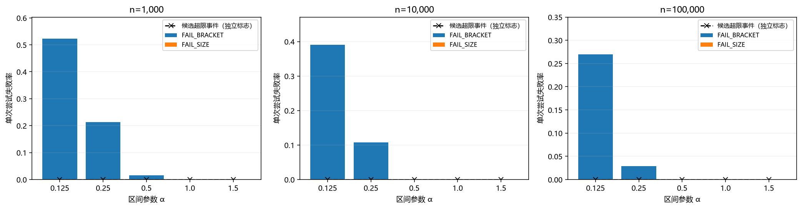
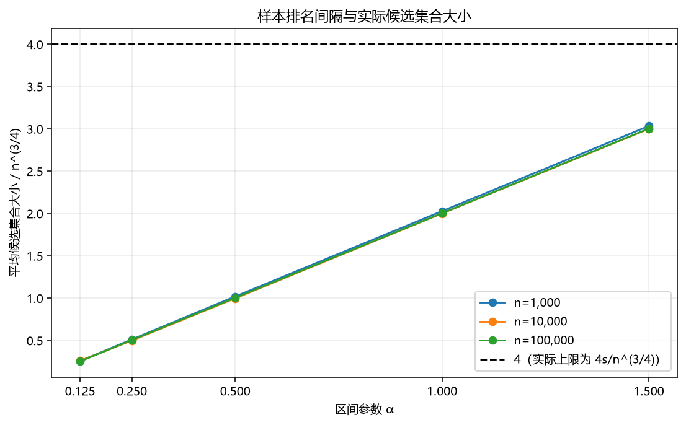
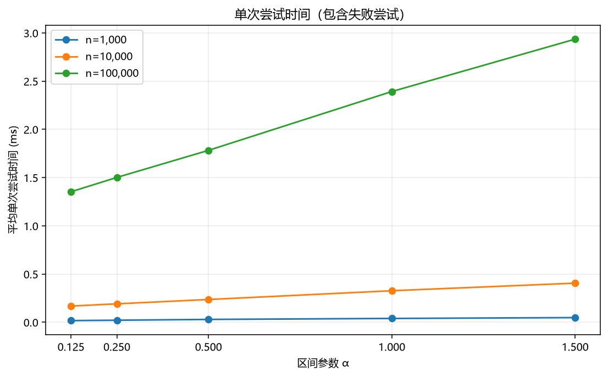
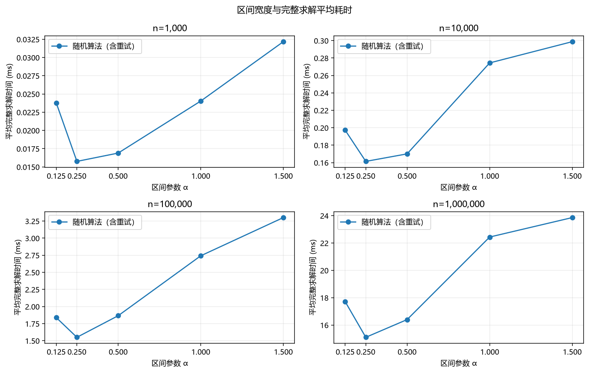
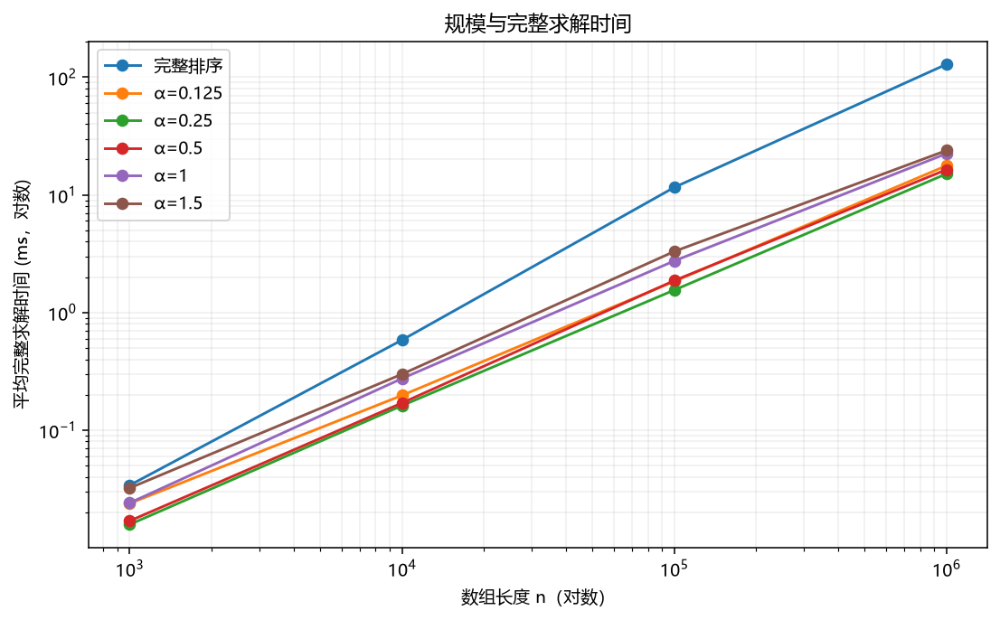
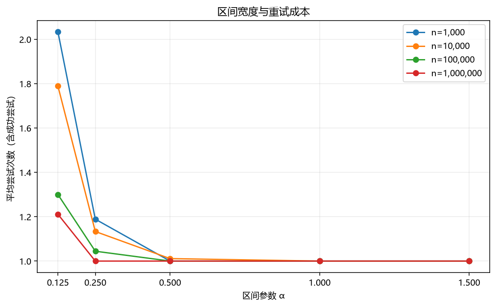
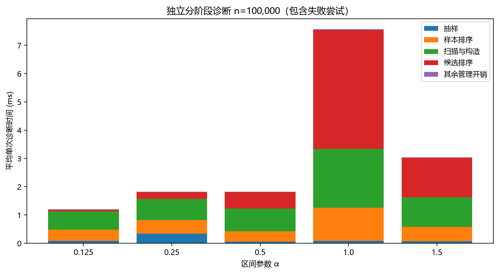

# 抽样区间宽度对随机化中位数算法性能的影响

实验日期：2026 年 11 月 3 日。本文基于默认正式配置的运行记录。

## 实验目的与要求

实现抽样式随机化中位数算法，固定样本量 $s=\lceil n^{3/4}\rceil$，改变区间参数 $\alpha\in\{0.125,0.25,0.5,1,1.5\}$（以 $\alpha=1$ 为参照设置）。比较单次正确性、失败原因、实际候选集合大小、单次尝试时间及含失败重试的完整求解时间。

区间宽度指样本排序后的排名间隔，而非数值差 $u-d$。实验分别记录样本量 $s$、样本边界排名 $j_{\rm low},j_{\rm high}$ 和原数组实际候选个数 $|C|$。

## 中位数定义与输入前提

输入为非空、元素互异的 `int64_t` 数组。目标为第 $r=\lfloor n/2\rfloor+1$ 小的元素（偶数长度取上中位数），参考答案取自完整排序后的 `sorted[n/2]`。

实验数据采用 $1,\ldots,n$ 的随机排列（基于 C++ `mt19937_64` 与 Fisher–Yates 洗牌生成），数据种子与算法抽样种子分开记录。算法采用有放回均匀采样，保留样本中重复抽中的元素。

输入预检查通过排序副本检测相邻元素，拒绝含重复值的输入。预检查与参考答案计算均不计入核心耗时。算法对所有测试规模（本次运行至 $10^6$）执行统一逻辑，不设小规模直接排序分支。需注意，实验加速比仅反映满足无重复前提下的核心求解开销，实际应用中若对未知输入做完整排序预检查，还需额外 $O(n\log n)$ 成本。

## 算法及参数化方式

单次尝试按以下步骤执行：

1. 从原数组独立、均匀、有放回地抽取 $s$ 个元素构成样本 $R$，用 `std::sort` 排序。
2. 计算 1-based 排名：

$$
j_{\rm low}=\operatorname{clamp}\!\left(\left\lfloor s/2-\alpha\sqrt n\right\rfloor,1,s\right),
\qquad
j_{\rm high}=\operatorname{clamp}\!\left(\left\lceil s/2+\alpha\sqrt n\right\rceil,1,s\right).
$$

3. 取 $d=R[j_{\rm low}-1]$、$u=R[j_{\rm high}-1]$，扫描原数组构造候选集 $C=\{x:d\le x\le u\}$，统计 $l_d=\#\{x<d\}$、$l_u=\#\{x>u\}$。
4. 若 $l_d<r\le n-l_u$ 不成立，返回 `FAIL_BRACKET`；否则若 $|C|>4s$，返回 `FAIL_SIZE`。
5. 两项检查均通过后，用 `std::sort` 排序 $C$，返回 $C[r-l_d-1]$。

原始记录同时保留“目标排名在区间内”、“候选集合超限”及“两端排名是否夹取”等独立状态。

完整求解从初始 seed 初始化随机状态，失败后推进同一状态重新抽样，最多尝试 100 次；达到上限返回 `RETRY_LIMIT`，并记录耗时与尝试次数。

## 正确性与复杂度

### 成功结果的正确性

扫描后，原数组被划分为小于 $d$、位于 $[d,u]$ 和大于 $u$ 三部分，大小分别为 $l_d,|C|,l_u$，故 $|C|=n-l_d-l_u$。当 $l_d<r\le n-l_u$ 时，目标即为 $C$ 中第 $r-l_d$ 小的元素（零基下标 $r-l_d-1$），排序后返回该位置必等于参考中位数。单次尝试失败仅触发重试，不会产生错误结果。

### 单次尝试与完整求解

$$
T_{\rm attempt}=O(s\log s+n+|C|\log |C|).
$$

候选排序仅在 $|C|\le4s$ 时执行；因 $s=\lceil n^{3/4}\rceil$ 且 $n^{3/4}\log n=O(n)$，单次最坏时间为 $O(n)$。成功尝试的样本和候选存储空间为 $O(s)$，构造失败候选时最坏额外空间为 $O(n)$。不同固定 $\alpha$ 的单次渐近复杂度相同，实测差异反映常数因子与重试成本。

若独立尝试成功概率为 $p>0$，无限重试的期望尝试次数为 $1/p$，期望工作量为 $O(n/p)$（当 $p$ 有正常数下界时为期望 $O(n)$）。限制重试上限为 $L$ 时，超限概率为 $(1-p)^L$。耗时统计包含所有失败重试开销。

### 参照参数的概率上界与实测对比

以下针对 $\alpha=1$（不发生排名夹取）给出保守上界推导。样本中小于或不大于目标的元素个数服从二项分布，方差至多 $s/4$。两端未括住目标要求偏离样本中心至少约 $\sqrt n$，可得：

$$
\Pr(\text{FAIL\_BRACKET})\le \frac{s}{2n}.
$$

若两端在原数组中的排名均位于 $[r-2s,r+2s-1]$，则 $|C|\le 4s$。超限必有一端超出该范围，对应样本计数与边界排名的期望间隔至少为 $\sqrt n-1$（利用 $s^2/n\ge\sqrt n$ 并计入取整误差）。由 Chebyshev 不等式及并集上界：

$$
\Pr(\text{一次失败})\le
\frac{s}{2n}+\frac{s}{2(\sqrt n-1)^2}
=O(n^{-1/4}).
$$

参照参数 $\alpha=1$ 的理论保守上界与实测结果对比如下：

| $n$ | $s$ | 下述保守失败概率上界 | $\alpha=1$ 实测失败率 |
|---|---|---|---|
| 1000 | 178 | 0.183908 | 0.0 |
| 10000 | 1000 | 0.101015 | 0.0 |
| 100000 | 5624 | 0.056419 | 0.0 |

注：1000 次试验未观察到失败，对应失败概率的 Wilson 95% 置信区间上限约为 0.38%。

## 环境、种子与计时口径

| 项目 | 实际记录 |
|---|---|
| 操作系统 | Windows-11-10.0.26100-SP0 |
| 编译器 | g++ (Rev5, Built by MSYS2 project) 16.1.0 |
| 编译选项 | -std=c++17 -O2 -Wall -Wextra |
| 架构 | AMD64 |
| 处理器标识 | Intel64 Family 6 Model 190 Stepping 0, GenuineIntel |
| 调度 Python | 3.12.10 (tags/v3.12.10:0cc8128, Apr  8 2025, 12:21:36) [MSC v.1943 64 bit (AMD64)] |
| 核心计时 | std::chrono::steady_clock，纳秒 |
| 构建程序 SHA-256 | 35cbd486de119d7a7eed3f007ef30128630615b4325065476db9351f42fd98b3 |

- 单次尝试：$n=1000,10000,100000$，每组参数运行 1000 次，数据种子 101，共 15000 条记录。
- 完整求解：$n=1000,10000,100000,1000000$，数据种子 101、202、303，每组预热 2 次、正式记录 30 次（每规模/设置共 90 条），含排序基线共 2160 条记录。
- 分阶段诊断：$n=100000$，每个 $\alpha$ 运行 20 次，独立于主实验，共 100 条记录。
- 种子配置：抽样主种子 2026110301，调度主种子 2026110302（详情见 `run_manifest.json`）。
- 新种子确认：使用数据种子 404、505、606，抽样/调度主种子 2026110303/2026110304，对比 $\alpha=0.125,0.25,0.5$，预热 2 次、测量 30 次，含排序基线共 1440 条记录。

同一轮试验中不同 $\alpha$ 采用相同初始抽样 seed 进行配对比较，并随机打乱执行顺序以减轻系统偏差。

输入副本在计时前准备。核心计时包含随机引擎初始化、抽样、两次排序、扫描与候选构造及失败重试；不含数据生成、I/O、预检查与结果校验。排序基线仅计完整排序与读取中位数时间。

统计指标（均值、中位数、基于最近秩 $x_{\lceil0.95m\rceil}$ 的 P95）均包含失败重试耗时。加速比定义为同规模完整排序平均时间除以随机算法平均总时间。

## 正确性和功能检查

C++ 单元测试共通过 9915 项断言（含 3300 次单次检查：2775 次成功、525 次预期内失败），覆盖：

- $n=1,2,3$ 边界、奇偶长度、正负数、有序/逆序/随机排列、五种 $\alpha$ 及多个固定种子。
- 候选排名换算、排名夹取、`FAIL_BRACKET`、`FAIL_SIZE`、两类失败同时发生、多次重试成功及 `RETRY_LIMIT`（单元测试通过注入特定采样序列触发边界分支）。
- 重复输入拒绝、空输入、非法参数及 CLI 异常检查（记录于 `tests.json`）。

正式实验共 17260 条记录，其中成功记录 15705 条、允许的失败记录 1555 条；确认实验共 1440 条记录，均成功返回答案。两批实验中，所有成功返回的答案均与参考排序一致，允许的失败已单独统计，完整求解均未触发 `RETRY_LIMIT`。主实验中未观测到 `FAIL_SIZE` 或排名夹取事件。

## 单次成功率与候选集合

| $n$ | $\alpha$ | 成功/1000 | FAIL_BRACKET | FAIL_SIZE | 平均 $\lvert C\rvert$ | 中位数 $\lvert C\rvert$ | 平均 $\lvert C\rvert/n^{3/4}$ | 平均尝试时间 (ms) |
|---|---|---|---|---|---|---|---|---|
| 1000 | 0.125 | 477 | 523 | 0 | 45.68 | 43.00 | 0.2569 | 0.017148 |
| 1000 | 0.25 | 787 | 213 | 0 | 90.86 | 88.00 | 0.5110 | 0.021047 |
| 1000 | 0.5 | 984 | 16 | 0 | 181.21 | 179.00 | 1.0190 | 0.029335 |
| 1000 | 1.0 | 1000 | 0 | 0 | 360.46 | 358.50 | 2.0270 | 0.039424 |
| 1000 | 1.5 | 1000 | 0 | 0 | 539.35 | 538.00 | 3.0330 | 0.048013 |
| 10000 | 0.125 | 609 | 391 | 0 | 258.73 | 256.50 | 0.2587 | 0.167642 |
| 10000 | 0.25 | 892 | 108 | 0 | 497.92 | 495.00 | 0.4979 | 0.191067 |
| 10000 | 0.5 | 1000 | 0 | 0 | 997.01 | 996.50 | 0.9970 | 0.235886 |
| 10000 | 1.0 | 1000 | 0 | 0 | 2000.03 | 1997.00 | 2.0000 | 0.326727 |
| 10000 | 1.5 | 1000 | 0 | 0 | 2999.32 | 3001.00 | 2.9993 | 0.405373 |
| 100000 | 0.125 | 730 | 270 | 0 | 1415.10 | 1414.00 | 0.2516 | 1.353220 |
| 100000 | 0.25 | 971 | 29 | 0 | 2833.36 | 2825.50 | 0.5038 | 1.501642 |
| 100000 | 0.5 | 1000 | 0 | 0 | 5641.00 | 5642.50 | 1.0031 | 1.782532 |
| 100000 | 1.0 | 1000 | 0 | 0 | 11261.28 | 11255.50 | 2.0026 | 2.392298 |
| 100000 | 1.5 | 1000 | 0 | 0 | 16885.88 | 16899.50 | 3.0028 | 2.935459 |

实验表明，区间越窄，候选集合 $|C|$ 越小，单次耗时越低，但 `FAIL_BRACKET` 失败率显著上升：$\alpha=0.125$ 在三种规模下的成功率分别为 47.7%、60.9%、73.0%；$\alpha=0.25$ 提升至 78.7%、89.2%、97.1%；$\alpha=0.5$ 仅在 $n=1000$ 时出现 16 次失败，其余规模及 $\alpha\ge 1.0$ 均全部一次成功。

在均匀排列与有放回抽样下，实测平均 $|C|/n^{3/4}$ 接近 $2\alpha$（统计涵盖全部尝试样本，详情见 `attempt_summary.csv`）。

## 完整求解与最佳参数

| $n$ | 方法 | 平均总时间 (ms) | 中位数 (ms) | P95 (ms) | 平均尝试次数 | RETRY_LIMIT | 加速比 |
|---|---|---|---|---|---|---|---|
| 1000 | 完整排序 | 0.033968 | 0.031900 | 0.039200 | 1.000 | 0 | 1.00 |
| 1000 | $\alpha=0.125$ | 0.023770 | 0.013950 | 0.059200 | 2.033 | 0 | 1.43 |
| 1000 | $\alpha=0.25$ | 0.015752 | 0.013600 | 0.028500 | 1.189 | 0 | 2.16 |
| 1000 | $\alpha=0.5$ | 0.016893 | 0.016400 | 0.020100 | 1.000 | 0 | 2.01 |
| 1000 | $\alpha=1.0$ | 0.024029 | 0.023950 | 0.029000 | 1.000 | 0 | 1.41 |
| 1000 | $\alpha=1.5$ | 0.032169 | 0.030100 | 0.035500 | 1.000 | 0 | 1.06 |
| 10000 | 完整排序 | 0.582880 | 0.506100 | 1.039300 | 1.000 | 0 | 1.00 |
| 10000 | $\alpha=0.125$ | 0.197201 | 0.139200 | 0.555700 | 1.789 | 0 | 2.96 |
| 10000 | $\alpha=0.25$ | 0.161376 | 0.123800 | 0.291800 | 1.133 | 0 | 3.61 |
| 10000 | $\alpha=0.5$ | 0.169998 | 0.145400 | 0.297000 | 1.011 | 0 | 3.43 |
| 10000 | $\alpha=1.0$ | 0.274363 | 0.200600 | 0.497000 | 1.000 | 0 | 2.12 |
| 10000 | $\alpha=1.5$ | 0.298732 | 0.252400 | 0.594300 | 1.000 | 0 | 1.95 |
| 100000 | 完整排序 | 11.575287 | 9.749100 | 23.518700 | 1.000 | 0 | 1.00 |
| 100000 | $\alpha=0.125$ | 1.838288 | 1.391550 | 4.984000 | 1.300 | 0 | 6.30 |
| 100000 | $\alpha=0.25$ | 1.549788 | 1.207700 | 2.999300 | 1.044 | 0 | 7.47 |
| 100000 | $\alpha=0.5$ | 1.865501 | 1.408500 | 4.165300 | 1.000 | 0 | 6.20 |
| 100000 | $\alpha=1.0$ | 2.741866 | 1.851700 | 7.909800 | 1.000 | 0 | 4.22 |
| 100000 | $\alpha=1.5$ | 3.300524 | 2.558550 | 8.280400 | 1.000 | 0 | 3.51 |
| 1000000 | 完整排序 | 128.901324 | 122.102550 | 210.689300 | 1.000 | 0 | 1.00 |
| 1000000 | $\alpha=0.125$ | 17.713048 | 13.109150 | 34.880600 | 1.211 | 0 | 7.28 |
| 1000000 | $\alpha=0.25$ | 15.101448 | 12.883100 | 30.861400 | 1.000 | 0 | 8.54 |
| 1000000 | $\alpha=0.5$ | 16.396284 | 14.063700 | 25.707300 | 1.000 | 0 | 7.86 |
| 1000000 | $\alpha=1.0$ | 22.433594 | 18.921750 | 39.879100 | 1.000 | 0 | 5.75 |
| 1000000 | $\alpha=1.5$ | 23.855930 | 20.775600 | 40.008000 | 1.000 | 0 | 5.40 |

以平均总时间为指标，主实验中各规模的最优参数汇总如下：

| $n$ | 均值最小的 $\alpha$ | 平均总时间 (ms) | 中位数 (ms) | P95 (ms) | 平均尝试次数 | 相对排序加速比 | 次优均值差距 |
|---|---|---|---|---|---|---|---|
| 1000 | 0.25 | 0.015752 | 0.013600 | 0.028500 | 1.189 | 2.16 | 7.24% |
| 10000 | 0.25 | 0.161376 | 0.123800 | 0.291800 | 1.133 | 3.61 | 5.34% |
| 100000 | 0.25 | 1.549788 | 1.207700 | 2.999300 | 1.044 | 7.47 | 18.62% |
| 1000000 | 0.25 | 15.101448 | 12.883100 | 30.861400 | 1.000 | 8.54 | 8.57% |

较窄区间（如 $\alpha=0.125$）单次候选排序量小，但失败重试较多；较宽区间（如 $\alpha\ge 1.0$）在本次主实验中均一次成功，但候选排序开销较大。综合两者，主实验在四个规模下的平均耗时最低项均为 $\alpha=0.25$。

### 新数据和新抽样种子确认

为检查主实验最低均值参数及其两侧相邻候选的稳定性，进一步使用新种子对 $\alpha\in\{0.125,0.25,0.5\}$ 进行确认实验：

| $n$ | 新种子均值最低的 $\alpha$ | 平均总时间 (ms) | 原候选 0.125 (ms) | 原候选 0.25 (ms) | 原候选 0.5 (ms) |
|---|---|---|---|---|---|
| 1000 | 0.25 | 0.024204 | 0.032729 | 0.024204 | 0.026468 |
| 10000 | 0.5 | 0.222066 | 0.318922 | 0.270088 | 0.222066 |
| 100000 | 0.5 | 1.968789 | 2.064833 | 1.988478 | 1.968789 |
| 1000000 | 0.125 | 17.736016 | 17.736016 | 19.268757 | 19.110909 |

新种子实验中，部分规模的最低均值参数发生变化，未出现跨批次、跨规模一致领先的参数；部分候选在特定规模下表现接近。例如，确认实验在 $n=100000$ 时，$\alpha=0.25$ 与 $\alpha=0.5$ 的平均耗时相差约 1.0%；在 $n=10000$ 时，$\alpha=0.125$ 的平均耗时则比 $\alpha=0.5$ 高约 43.6%。

## 分阶段诊断

| $\alpha$ | 抽样 (ms) | 样本排序 (ms) | 扫描与构造 (ms) | 候选排序 (ms) | 其他开销 (ms) | 总时间均值 (ms) | 总时间中位数 (ms) |
|---|---|---|---|---|---|---|---|
| 0.125 | 0.082450 | 0.399395 | 0.641385 | 0.063015 | 0.014585 | 1.200830 | 0.922850 |
| 0.25 | 0.332135 | 0.486450 | 0.753675 | 0.233155 | 0.016270 | 1.821685 | 1.505550 |
| 0.5 | 0.061470 | 0.366440 | 0.799740 | 0.579610 | 0.013210 | 1.820470 | 1.296600 |
| 1.0 | 0.084515 | 1.164865 | 2.087020 | 4.209485 | 0.015650 | 7.561535 | 2.406500 |
| 1.5 | 0.064170 | 0.519115 | 1.041170 | 1.397805 | 0.015200 | 3.037460 | 2.236400 |

诊断实验对抽样、样本排序、扫描与候选构造、候选排序四个阶段分别计时；“其他开销”为总时间减去四阶段之和（含 RNG 初始化、内存分配及排名计算等），失败尝试中未执行的候选排序计为 0。

较宽区间通常带来更多候选排序工作，但本批诊断的候选排序耗时均值并不严格单调。诊断样本量较小（20 次），且存在少数慢记录，尤其 $\alpha=1.0$ 的均值明显高于中位数；其原因可能涉及系统调度等因素，阶段数据主要用于定性观察耗时结构。

## 局限与改进方向

- 数据分布：正式性能测试仅采用 $1,\ldots,n$ 的随机排列，未来可扩展测试高度偏斜或特定规律分布的数据。
- 计时波动：测试在常规操作系统环境下进行，存在后台任务与频率波动导致的尾部延迟（故报告同时提供中位数与 P95）。
- 重复值处理：当前版本拒绝含重复元素的输入；若需支持通用多重集，可将元素扩展为 `(数值, 原始下标)` 的复合全序结构。
- 工程优化：在保持算法核心逻辑（两次排序）不变的前提下，可进一步探索预分配复用缓冲区、限制候选集构造时的内存写入上限等工程优化手段。

## 复现与文件结构

- 核心代码与测试：`src/median.hpp`、`src/driver.cpp`；单元测试位于 `tests/test_median.cpp`。
- 脚本与配置：默认配置见 `config.json`；实验调度、统计分析、绘图与报告生成分别对应 `tools/` 下的 `run.py`、`analyze.py`、`plot.py` 和 `report.py`。
- 数据存档：`results/raw` 保存主实验与诊断的原始 CSV 记录；`results/confirmation` 保存新种子确认数据。汇总指标保存在各汇总 CSV 中，`results/audit.json` 与 `results/confirmation/audit.json` 分别记录两批实验的原始数据与汇总一致性校验结果及原始文件哈希。完整字段说明及复现命令详见 `README.md`。
